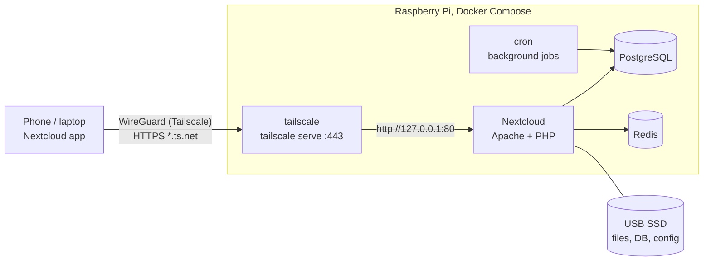

# pi-private-cloud

A private Google Drive / Dropbox replacement running on a Raspberry Pi.
[Nextcloud](https://nextcloud.com) stores the files, PostgreSQL and Redis keep
it responsive, and [Tailscale](https://tailscale.com) makes it reachable from
your phone and laptop anywhere, over HTTPS, without opening a single port on
your router.



## Status

| | |
|---|---|
| Configuration validated | `docker compose config`, `shellcheck`, `yamllint`, JSON syntax |
| Deployed on hardware | **Not yet.** Update this line once it runs on a Pi. |

## Why this stack

I compared the common self-hosted options before choosing. The short version:

| Decision | Choice | Why | Alternatives considered |
|---|---|---|---|
| File server | **Nextcloud** | Most complete ecosystem (desktop sync, mobile apps with auto photo upload, calendar, contacts) and the best-known name in self-hosting. | **OpenCloud / ownCloud Infinite Scale** use far less RAM at idle (~70 MiB vs ~240 MiB in one comparison) and are worth considering on a 2–4 GB Pi, but have a smaller app ecosystem. **Seafile** syncs fast but is harder to run on ARM. |
| Deployment | **Docker Compose** with the official `nextcloud` image | Every service is pinned, reproducible and replaceable. | **Nextcloud AIO** is easier to click through, but it does not allow an IP address instead of a domain, and it hides the parts this project is meant to show. |
| Database / cache | **PostgreSQL 17 + Redis** | Recommended for anything beyond a single test user; Redis handles file locking so sync clients do not collide. | SQLite (fine for testing only). |
| Remote access | **Tailscale** (`tailscale serve`) | No port forwarding, works behind CGNAT, real HTTPS certificate on a `*.ts.net` name, free for personal use. | **Cloudflare Tunnel**: Free-plan requests are capped at 100 MB, and Cloudflare's terms restrict serving large files through its free proxy, which is a poor fit for a file cloud. **Plain WireGuard**: needs a UDP port opened on the router. |
| Storage | **USB 3 SSD**, not the SD card | SD cards wear out under database writes and are slow. Nextcloud's own AIO docs advise against them. | |

Sources: [Nextcloud AIO README](https://github.com/nextcloud/all-in-one),
[OpenCloud vs ownCloud vs Nextcloud](https://computingforgeeks.com/opencloud-vs-owncloud-vs-nextcloud/),
[Tailscale vs Cloudflare Tunnel](https://hometechops.com/guides/home-remote-access-tailscale-vs-cloudflare-tunnel),
[Remote access without port forwarding](https://homelabstarter.substack.com/p/remote-access-without-port-forwarding),
[Cloudflare service-specific terms](https://www.cloudflare.com/service-specific-terms-application-services/),
[Cloudflare request limits](https://developers.cloudflare.com/workers/platform/limits/).

## Hardware

- Raspberry Pi 4 or 5 with **4 GB RAM minimum** (8 GB recommended)
- Official power supply (the Pi 5 needs the 27 W USB-C supply to power a USB SSD reliably)
- USB 3 SSD for storage
- 64-bit Raspberry Pi OS Lite on the SD card (the OS only, no data)

## Setup

**1. Install Docker on the Pi**

```bash
curl -fsSL https://get.docker.com | sh
sudo usermod -aG docker "$USER"   # log out and back in afterwards
```

**2. Mount the SSD.** Find it with `lsblk`, then format it once (this erases it):

```bash
sudo mkfs.ext4 -L pi-cloud /dev/sda1
sudo mkdir -p /mnt/ssd
echo 'LABEL=pi-cloud /mnt/ssd ext4 defaults,noatime,nofail 0 2' | sudo tee -a /etc/fstab
sudo mount -a
```

**3. Prepare Tailscale.** In the [Tailscale admin console](https://login.tailscale.com/admin):
enable **MagicDNS** and **HTTPS Certificates** under DNS, note your tailnet name
(for example `tail1234.ts.net`), and create a reusable **auth key** under Settings → Keys.

**4. Configure and start**

```bash
git clone https://github.com/ahsan217-beep/pi-private-cloud.git
cd pi-private-cloud
cp .env.example .env
nano .env                      # fill in auth key, tailnet, passwords
sudo bash prepare-storage.sh   # creates folders on the SSD, refuses to use the SD card
docker compose up -d
bash post-install.sh           # background jobs, maintenance window, DB indices
```

**5. Connect.** Install Tailscale on your phone or laptop, sign in to the same
tailnet, then open `https://pi-cloud.<your-tailnet>.ts.net` or point the
Nextcloud desktop/mobile app at that address.

## Operations

| Task | Command |
|---|---|
| Logs | `docker compose logs -f app` |
| Run any `occ` command | `docker compose exec -u www-data app php occ <command>` |
| Back up | `sudo bash backup.sh /mnt/backup-disk/pi-cloud` |
| Update within the major version | `docker compose pull && docker compose up -d` |
| Upgrade to the next major version | Change `nextcloud:35-apache` to `36-apache`, then pull and up. Nextcloud only upgrades **one major version at a time**, which is why the image is pinned. |

`backup.sh` puts Nextcloud in maintenance mode, dumps PostgreSQL, copies config
and data with `rsync`, keeps the 14 newest database dumps, and always switches
maintenance mode off again, even if a step fails.

## Security notes

- Nothing listens on the Pi's LAN interface. Nextcloud is reachable only from
  devices signed in to your tailnet.
- Tailscale Funnel (public internet exposure) is explicitly disabled in `serve.json`.
- Secrets live in `.env`, which is git-ignored.
- Back up to a second disk or machine. One SSD is a single point of failure.

## Limitations

- Sharing a public link with someone outside your tailnet needs extra setup
  (for example Tailscale Funnel or a Cloudflare Tunnel for that link only).
- Online document editing (Collabora / OnlyOffice) is not included. It needs
  several more GB of RAM than a 4 GB Pi comfortably has.

## See also

[ver.2 (pi-private-cloud-ver.2)](https://github.com/ahsan217-beep/pi-private-cloud-ver.2) sets up the same private cloud on a Raspberry Pi 5 booting from NVMe, using the Nextcloud Snap and two interactive scripts instead of Docker Compose. Its README has a side-by-side comparison of both versions.

## License

MIT, see [LICENSE](LICENSE).
